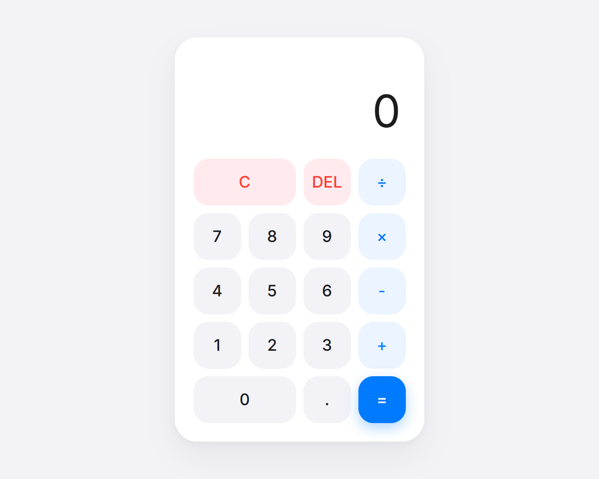

<p align="center">
  
</p>

Kalkulator web dari HTML, CSS, dan JavaScript murni. Tambah (+) dan kurang (-) gratis. Kali (×) dan bagi (÷) terkunci di balik langganan palsu. Pilihan paket hanya disimpan di `localStorage`, tidak ada pembayaran sungguhan.

<p align="center">
  
  &nbsp;&nbsp;
  
</p>

## Fitur

- Dukungan keyboard penuh: angka, `+ - * x /`, `Enter`, `Backspace`, `Esc`
- Paywall tiruan untuk kali dan bagi, dengan dua pilihan paket
- Status langganan tersimpan di `localStorage` (kunci `calc_tier`)
- Tanpa framework, dependensi, maupun build step

## Menjalankan

```bash
git clone https://github.com/Tedsani-Adinata/Calculator.git
```

Buka `index.html` di browser. Selesai.

Untuk mengunci ulang fitur premium, jalankan di console browser:

```js
localStorage.removeItem('calc_tier');
```

## Struktur

```
assets/   banner dan screenshot
css/      style.css
js/       script.js (logika kalkulator dan paywall)
index.html
```
